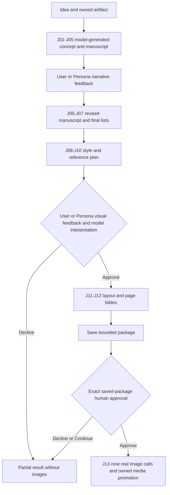

# Orchestrator Runs

Users select an enabled Workflow orchestrator at `/runs/new`. Its initial fields
and maximum price are shown before admission. `/runs` lists owned executions;
detail shows stage evidence, pending/submitted decisions, private results and
ordered attempts. Closing the browser does not stop the worker. Cancellation is
pending until provider termination is confirmed. Unknown acceptance/reconciliation
is visible and never creates a second generation request automatically.

Pending cancellation disables decision submission. The worker uses Dify's standard
workflow task-stop endpoint and retrieves the run independently. A successful
acknowledgement is not terminal evidence: retrieval must confirm termination
before releasing a hold or admitting another attempt. Dify can acknowledge
task-stop while a human-input workflow remains paused; that attempt correctly
stays unresolved. No custom Dify cancellation endpoint is required by this client.
Once Dify confirms `stopped`, an uncertain form submission does not block terminal
settlement. The worker also recovers previously reviewed jobs with saved stopped
evidence and `decision-outcome-unconfirmed`; unrelated review cases remain manual.

## Administration and setup

Use `/admin/settings` for branding/default appearance, credit packs/expiry, all
pricing modes, admission/reconciliation policy, media limits and cleanup defaults.
Saved settings seed from environment once. Later environment changes do not
replace saved policy. Public branding is allowlisted; user preferences override
defaults. New attempts/purchases use current policy, while accepted terms remain
frozen. Management/encryption secrets, provider/storage connections and deployment
identity remain in environment configuration. Managed app execution keys are
encrypted in MongoDB. Updates require fresh administrator authority,
a valid verified session, mutation protection, matching revisions and an atomic audit record. Change reasons are optional.
Previously initialized settings that lack upload limits read the original defaults:
20 MiB per file, 100 files and 100 MiB per account. Reading these defaults does not
rewrite saved settings or replace billing terms; explicitly saved limits still apply.

Configure `DIFY_MODE=live`, `DIFY_BASE_URL` ending `/v1`, `DIFY_CONSOLE_URL`
ending `/console/api`, `DIFY_MANAGEMENT_KEY` and `DIFY_WORKSPACE_ID`. Both URLs
must use the same instance. Enable self-hosted Dify admin-key authentication with
permissions to read apps/publications/tool configuration and create app keys.
Allow reading node execution traces for complete tracing after continuation.
Register requires draft-read and publication permissions. Create additionally
requires app-import and Web App setting permissions.

At `/admin/orchestrators`, **Create orchestrator** opens a template dropdown,
then imports the selected workflow without a form. Most templates publish and
register automatically. Case preparation stays a private draft until its country,
Dify Knowledge base and multimodal models are configured; publish it in Dify,
then Register it here. See the [template setup](../src/lib/server/runs/templates/README.md#case-preparation).
The server loads allowlisted JSON DSL files from `src/lib/server/runs/templates`;
only template names/descriptions reach the browser. Available scenarios:

| Template          | Scenario                                                | Required MCP tool                                 |
| ----------------- | ------------------------------------------------------- | ------------------------------------------------- |
| Document summary  | Fetch a guide and choose Brief/Detailed                 | `get_reference_document_v1`                       |
| Saved artifact    | Owned draft, approval/decline, persistent image         | Run context and artifact read/save/approval tools |
| Unitale           | Real J01-J13 comic, User/Persona reviews and nine provider images | Run context and artifact read/save/approval tools |
| Case preparation  | Multimodal evidence, fact review, country-law retrieval, approved brief | Run context and artifact read/save/approval tools |

The retained samples showcase basic MCP/human input, owned artifact
persistence/approval, and real comic production. Each template binds an
authorized provider with all required tools, preferring `unibase_starter`.
Missing tools stop creation before import. Persona completions are configured
separately and are not Orchestrator templates.
The Document summary binds `get_reference_document_v1` (preferring
`unibase_starter` when available). Start sends empty inputs; MCP fetches the synthetic
`unibase-demo` document; Generative UI asks Brief/Detailed; a prompted LLM consumes
the MCP JSON and raw response and returns ordinary End text. Configure its model
in Dify before use. Start a Run, choose an option, Continue,
then view its result and tracing. Existing published workflows use **Register**.
Create immediately shows the confirmed app and refreshes discovery automatically.
New starters disable the public Dify Web App (`enable_site=false`). API access and
the Human Input node's WebApp delivery stay enabled; they are separate settings.

**Register**, **Re-register**, and **Enable** open a version selector. Admins choose
the version used by future Runs; ordinary users use the registered version.
The selector shows the current Unibase workflow UUID, publication names/numbers
when available, creation dates in the account timezone, and paginated history.
It fetches ten Dify rows per page and excludes drafts from published choices.
**Load more versions** fetches the next page. Fetch failures can be retried by
closing and reopening the dialog.

Choose a published version, then **Register selected version**. This validates
that publication's graph, inputs, Human Input and MCP requirements without
publishing or restoring the draft. **Saved draft — publish if changed** explicitly
uses the saved Dify draft, publishing it when necessary. It does not upload local
JSON changes. The current UUID identifies Unibase's choice, which can differ from
Dify's latest publication. Version access/execution still depends on the connected
Dify installation and its permissions.

**Disable** stops new Runs. **Enable** validates the chosen version before
allowing new Runs. **Unregister** removes the Unibase registration from Run choices;
the workflow remains in Dify and can be registered again. Accepted Runs continue
using their saved configuration and credential; results, tracing and history remain.

Admin refresh and the Start page reconcile registered apps against a complete Dify
catalog. Missing apps remain visible in Admin as **Unavailable in Dify**, with
**Delete registration** to remove the stale entry. Deletion never recreates the
Dify workflow. Fresh admission also verifies the app, so a stale browser cannot
start a deleted workflow or reserve credits. Disable/unregister are fenced against
concurrent registration and admission. Both require recent administrator login.

Provider errors or incomplete catalogs do not mark workflows deleted. Saved entries
remain manageable when Dify is unavailable. Unregister retains a private tombstone
and encrypted credentials needed by accepted Runs; it does not delete history,
assets, Dify apps or Dify keys. A workflow deleted after admission may fail through
the normal provider reconciliation and credit-settlement rules.

Creation records an idempotency key before import and remembers the returned app
ID. Retrying a confirmed creation resumes publication/registration. An unknown
import outcome is never repeated automatically: check Dify and register the new
app if present. Changed drafts are not published automatically. Creation only
publishes its own new app; registration never changes existing graphs.
Explicit authentication/permission rejection permits retry after correction.
Create checks a saved app before retrying settings or registration. If it was
deleted in Dify, Unibase clears the browser's creation retry key and asks the admin
to click Create again for a new workflow. Temporary failures retain the key;
deleted apps are not silently recreated by a retry.

Saved-draft registration reads the saved draft, verifies supported inputs and declared Human
Input/MCP configuration, and publishes it when no publication exists or the draft
has changed. It rechecks the draft before publishing and verifies the resulting
publication. It then reuses or creates an encrypted execution key, checks API
access and saves an enabled Orchestrator. It never writes drafts, inserts nodes,
adds inputs or imports DSL. Repeating registration preserves an
unchanged definition. Incomplete registration is never enabled. Keys and active
registration are serialized to avoid duplicate creation; no graph-mutation journal
or Python sandbox adapter is required.

Explicit-version registration reads only the selected app's published history page
and derives its inputs from that exact graph. Dify's unversioned `/parameters`
describes the current publication, so it is not used to validate historical inputs.
The server verifies the app key and rechecks version membership/graph before
enabling the registration. Missing, draft, foreign-app or moved-page selections
fail without changing the prior definition; reload versions and choose again.
Selection is audited with its workflow UUID and uses the existing registration
lease, recent-admin checks and lifecycle fences. Accepted Run snapshots and
execution URLs retain their earlier workflow UUID; no data migration is needed.

A fit Workflow has a published Start/End graph and Service API access. Its Start
controls must be text, paragraph, number, select or a single file; user text is
bounded by Dify up to 4,000 characters. Controls are optional when Dify declares
them optional; inline prompts need no input field and send `inputs: {}`.

Human Input nodes must enable WebApp delivery and use supported native fields and
actions. For Generative UI, Dify renders the `unibase-ui` card payload and native
`response` paragraph placeholder; literal definitions are validated on registration,
dynamic definitions are validated after rendering. Referenced MCP providers must
be authorized in the workspace and have the selected tools synchronized. Checks
read stored metadata, never execute tools, ask a human to act or run an LLM as a
probe. Actual network/model/plugin readiness still needs a test Run. Workflows do
not need to use every capability on every execution.

Dify owns general graph editing and MCP provider credentials. Workflows are
authored in Dify; Register publishes their current valid saved draft. Create
authors and publishes only its starter. A connected MCP server
may expose permission-checked read or write tools; registration does not create
new tool implementations. Unibase includes public reference tools and optional
Run-scoped artifact reads/writes with explicit permissions and capability checks. See [MCP setup and boundaries](mcp.md).

User pages start Runs, list owned history and show status, tracing, decisions and
results. Native `workflow_run_id`/`task_id` values track execution. Human Input
submits its form token and reconnects the same provider Run. Tracing is the saved
node-event timeline; Dify log lists are Run summaries, not full node tracing.
Once retrieval confirms termination, the worker saves that outcome without
waiting on a live event stream. Replay remains necessary for uncertain decision
submissions; historical paused snapshots cannot replace confirmed termination.
Bounded terminal node metadata supplies the tracing timeline separately.
Accepted-execution timeouts use the saved polling interval; explicit provider
retry delays still take precedence. Generated files use short-lived signed links,
so collection must not wait for a long transport-error backoff.
Raw provider prompts, credentials and other users' Runs are never shown.

Manual JSON definitions, DSL routes and graph setup services have been removed.
Legacy definitions/accepted attempts remain readable; old provider-side adapters
are not removed automatically. Registration uses the current publication as-is.
Base settings and billing/history policies remain unchanged.

Managed keys use AES-256-GCM and are bound to the Dify instance, workspace and app.
Web and AI workers read them directly from MongoDB; new registrations need no
app-key environment edit or process restart. Keep the same encryption secret on
both processes. Optionally set `DIFY_CREDENTIAL_ENCRYPTION_KEY` to a stable 32-byte
secret encoded as 64 hexadecimal characters; otherwise a separate encryption key
is derived from `DIFY_MANAGEMENT_KEY` using HKDF-SHA256. Keep the encryption secret
outside MongoDB and back it up separately. Changing it requires reconnecting apps
or restoring the previous value; a dedicated secret allows management-key rotation
without re-encrypting credentials. Earlier credential records remain available to
accepted attempts. No app key is exposed in browser responses, audit events or
Run snapshots, and read/execution paths never create keys.

Key acquisition is serialized per app with a durable creation intent. After an
uncertain creation response, reconnect first checks the key list; it reuses a
returned key and does not issue another create if no usable key can be confirmed.
Resolve that case in Dify, then retry registration. Explicit provider rejection
(permissions/key limit) permits another attempt after correction. Removing a local registration does not delete or revoke Dify keys.

Registration uses recent administrator authentication, CSRF protection and fresh
role checks around credential acquisition and enabling. `orchestratorRegistrations`
retains sanitized progress and audit intent; provider graphs/secrets and MCP
credentials stay in Dify. A final publication read detects a version change before
enabling. Old mutation-intent records are retained as historical evidence but no
active path resumes graph modifications.

## Local live-service readiness

Local Dify Runs need two network directions: the AI worker calls Dify, and Dify
calls the private MCP endpoint for Run context and artifact tools. Launching a
worker under a restricted process environment can make the web interface work
while execution reports `transport`. A heartbeat confirms the worker loop, not
provider or callback connectivity. Verify the configured connections from the
actual worker environment before starting another Run.

For a local callback tunnel, keep its MCP-only proxy and tunnel running. Check
that unrelated paths return 404 and anonymous MCP requests return 401, then
reconnect/refresh the existing provider in Dify. Temporary quick tunnels can
reconnect intermittently; they are development ingress, not hosted reliability
acceptance. A failed MCP step should settle at zero under success-only pricing.
If a dispatch outcome is unknown and no execution ID was recorded, its hold
remains for audited administrator review; do not replay the POST or erase history.

The Run screen clears a read warning after successful manual or automatic
refresh. Action errors remain visible across successful polling and clear when
that action is retried. This keeps recovered network errors from appearing as
ongoing failures without hiding a rejected approval or command.

The saved-artifact example routes explicit Decline and interpreted non-approval
to `draft_result` with outcome `partial`, retained text and no images. Only the
approval path returns a successful illustrated result. Under success-only
pricing, decline settles at zero. Updating a local template does not repair an
existing publication; publish and re-register the reviewed graph explicitly.

## Versioned application contract

Local Run and attempt IDs identify owned history, retries and credit records.
The worker maps each attempt to Dify's `workflow_run_id` and `task_id` from
execution events. Dify returns these identities; it does not require matching
Start inputs. Run detail and reconnect use the provider Run ID, while stop uses
the task ID. Node events provide the persisted application progress timeline.
Dify's workflow logs are run summaries, not node-level tracing.
See [Workflow API](https://docs.dify.ai/en/api-reference/guides/workflow).

Registration never adds `unibase_run_id`, `unibase_attempt_id` or
`unibase_recovery`. Deprecated fields already declared by an existing workflow
remain server-filled for compatibility, with `legacyInputs` recording exactly
which fields to send. Older accepted snapshots retain their existing dispatch
shape. Recovery data belongs to the legacy checkpoint/restart feature; it is not
needed to resume Human Input. New registration does not enable custom recovery.
User controls come solely from Dify; there is no mandatory prompt field.

Unibase normalizes ordinary End outputs on its server. A single string is response
text, several outputs retain their values as JSON text, and an empty output is
an empty response. No special End name or provider-side adapter is required.
Explicit application envelopes retain `version:1`, `outcome:success|failed|partial`,
`text`, `cards`, `images` and safe optional failure/checkpoint data. Claimed rich
envelopes must validate; invalid rich data is never accepted as ordinary text.
Envelopes use `result`, or the sole output `draft_result` for unapproved branches.
These distinct names satisfy Dify's graph-wide End output uniqueness rule while
preserving partial outcomes and their settlement behavior.
Provider execution failures follow the durable worker policy.

Cards are versioned registered question, form, summary, gallery, progress and
issue data. Forms support choices, toggles, numbers and bounded text. Unknown or
malformed UI cannot submit. Gallery references must belong to the same Run.
Images carry validated base64 bytes and UUID references; the app remaps them to
private owned asset IDs. Arbitrary fetch URLs and executable HTML/React are absent
from the contract. The shared schemas in `src/lib/contracts/runs.ts` and
`src/lib/runs/cards.ts` are authoritative; sample DSL is under `dify/`.

The parent Human Input form has one fenced `unibase-ui` JSON payload, a paragraph
input named `response`, the native `{{#$output.response#}}` placeholder and Dify
continuation actions. The server submits `{action,inputs:{response},user}` with
the original opaque user. New registrations use `raw-v1`: text stays exact and
other JSON values are serialized once. Human submissions use `{key,action,response}`;
legacy snapshots retain `{key,action,answers}` and validated card-answer JSON.
Raw questions require a paragraph `response` input and a `continue` action.
Native selects and owned file forms remain supported on the legacy path. Form tokens remain server-side;
application decision IDs and current ownership control access. Submission intent
precedes the provider request. Unknown responses are reconciled from evidence
without blindly resubmitting. Expired/unavailable forms show clear status.

Workflow tools cannot pause for Human Input in 1.17.1. Child tools return question
data; their parent pauses and routes answers. Display child calls as parent stages.
Standalone Agent/Chatflow modes and arbitrary internal child tracing are outside
this contract. The parent published UUID is pinned for accepted attempts. Pin child
publications in tool configuration wherever supported and revalidate after edits.

## Credits and recovery

Default: reserve one credit, charge one on successful completion and release on
confirmed failure/cancellation. Admin policies support fixed, total/split tokens,
provider cost and hybrid prices, including free execution. Verified-usage failure
billing omits fixed base charges. Unconfirmed decision submissions also retain their hold for administrator review when snapshot evidence cannot confirm them. Missing usage requires review rather than an
estimated charge. Reopening/polling/decisions never reserve again.

Retry stage requires declared compatible checkpoint version/stage data; otherwise
restart with editable initial inputs and latest enabled configuration. Both create
new linked attempts and disclose current maximum pricing. Uncertain attempts
cannot restart without provider evidence or explicit audited administrator
resolution. Resolution does not stop a provider execution and can permit duplicate
work; Administration states this when resolving. Diagnostic testing is admin-only
and requires the orchestrator's declared diagnostic entry point. Unsupported
stages require a full run. Failed/partial results and previous attempts remain.

Failed executions show a safe diagnostic summary from Dify, including known MCP
connection, tool-service HTTP 502/503/504, tool-output, authentication,
model/provider and timeout failures.
Raw provider error text stays private. Older failures without retained diagnostics
say that no error details were saved. Terminal Runs without stage history say that
no stage details were recorded. A business partial result keeps its partial status and
is not given a generic execution-failure message.

## Pinned API evidence

The integration targets [Dify 1.17.1 admin authentication](https://github.com/langgenius/dify/blob/1.17.1/api/extensions/ext_login.py),
[workflow event reconnect](https://github.com/langgenius/dify/blob/1.17.1/api/controllers/service_api/app/workflow_events.py),
[Human Input forms](https://github.com/langgenius/dify/blob/1.17.1/api/controllers/service_api/app/human_input_form.py),
[stream payloads](https://github.com/langgenius/dify/blob/1.17.1/api/core/app/entities/task_entities.py),
[DSL import](https://github.com/langgenius/dify/blob/1.17.1/api/controllers/console/app/app_import.py),
and [workflow tools](https://github.com/langgenius/dify/blob/1.17.1/api/core/tools/workflow_as_tool/tool.py).
Fixture verification does not substitute for live acceptance on the configured
installation. See [AI testing](ai-testing.md).

## Answering as a persona

Start Run accepts optional `answerer` (`{type:"user"}` or a persona ID, revision
and configuration key) and optional owned `artifactId`. Persona definitions live
at `/admin/personas`; mutations use recent administrator authority, CSRF, revision
checks and audits with optional change reasons. The admin page lists persona cards;
Add and Edit open a dialog, and cancelling Add does not create a persona.
Disabled/archived/unavailable personas cannot admit new attempts. Accepted attempts preserve their previous configuration.

Responder workflows declare exactly three required paragraph controls: `persona`,
`question`, and `context`, each bounded to 4,000 characters, plus an End `answer`
output containing the raw answer. They need an LLM and no Human Input or
external tool nodes. This contract derives registration purpose `responder`.
The template is Start → LLM → End, passing the raw LLM text to `answer`, without
Python or an enforced output schema. It accepts text or serialized questions of
any shape. In `raw-v1`, Unibase sends the rendered question directly and does not
parse persona output into fields, remove nulls, infer choices, or require an
envelope. Strings, objects, arrays, numbers, booleans and null are valid within the
4,000-character transport limit. The next workflow LLM interprets the response.
Raw child billing validates transport and provider usage, not semantic form shape.
Use Dify to configure the actual model and re-register after edits.

The legacy path sends rendered questions, constraints, allowed actions, explicit card
answer contracts, initial inputs and previous decisions. Summary/issue cards use
null acknowledgements; when a persona chooses an offered action, omitted
acknowledgement keys are normalized to null. Invalid supplied values and missing
choices/form fields still fail validation. It excludes service credentials, form tokens and Run
capabilities. The parent workflow receives only ordinary answers. Native text,
select and registered Generative UI responses share human validation. File
questions, malformed answers, unavailable forms and exceeded limits pause for the
user. Unknown responder outcomes require reconciliation rather than redispatch.

The legacy adapter retains `{action,answers}`, single-action answer maps, omitted
acknowledgements and optional-null normalization. Old publications may retain
their Python normalizer. Existing registrations and accepted attempts retain
their mode and pinned version; re-registration never switches their response mode.
Create a new app from the updated template to adopt raw responses. Raw mode still
checks renderable UI, action metadata, permissions, payload bounds and execution
state. It never treats raw text as verified human approval.

`take-over` switches remaining decisions to User and cancels unfinished responder
executions; submitted/uncertain decisions reconcile before another answer. History
records persona ID/revision separately from human decisions. Optional structured
UI `approval` binds artifact ID, revision, content hash, action and `requireHuman`;
services check persisted evidence rather than model claims. Personas may approve
when the product permits them; human-required approvals fall back to User.

Default responder pricing is one credit per valid completed answer, with ten calls
(maximum configurable 1-100). Admission discloses/reserves parent plus responder
maximum once. Main and responder charges remain separate; valid completed answers
are charged even after takeover, failure or cancellation. Required missing usage
or unknown child termination prevents combined settlement and retains the hold.
A valid child with missing price evidence remains reviewable; an audited child
waiver permits the parent to settle without that fee. Child fees are attributed
in the parent transaction and shown alongside usage without a second wallet debit.
Restart/recovery selects the answerer again and snapshots current terms.

## Saved-artifact integration

`/artifacts` shows saved revisions independently of Runs. Its **Create with a Run**
action opens Start Run, which creates owned records during submission. Associated
workflows require an owned artifact at admission. Sample MCP
operations save a deterministic draft with a stable operation key and expected
revision, then approve only its exact persisted decision target. Decline keeps
the draft unapproved. Terminal sample results include a synthetic validated image.

Start Run lists all available ordinary workflows. Workflows needing an artifact
show a create/select section; others start without one. New artifacts are created
with the same submission as the Run, using one button. Starting from an artifact
preselects it and shows its title and revision. The review panel shows the answerer,
destination and combined maximum reservation before submission. Required inputs
are checked before creating an artifact. Uncertain responses retain an immutable
request for safe retries using the same artifact ID and Run idempotency key;
confirmed pre-admission validation errors allow editing again.

Artifact revisions are expandable, newest first, with the latest revision open
by default. Retained images appear inside the revision from their source attempt.
When an attempt saves several revisions, its terminal images appear once, in its
final saved revision. Expanding history leaves the latest revision open.

Result application is a separately journaled typed server handler, keyed by
attempt and handler version. The worker promotes images and updates product
references transactionally. A failed application appears as **Product save:
failed** with **Retry product save**; retry creates no generation or extra charge.
Deletion releases product references. Run history retains its own object until
cleanup, and retained product images remain accessible after that cleanup.

### Unitale real comic workflow

Unitale (`story-panel`) implements the POC's J01-J13 responsibilities using four
real LLM steps, bounded Code nodes and nine real image-tool calls. Select an owned
artifact and enter an idea; the model creates a matching story, two characters,
one main location and three pages. **User** or **Persona** can review the narrative
and visual plan in ordinary language. Model steps interpret feedback rather than
requiring a Persona to return UI transport JSON. Users Save response / Continue.
Final approval is human-only and revision/hash-bound, so Persona mode deliberately
hands control back to a user. Continue at that final decision keeps an unapproved
draft and returns partial.

The package fits the existing artifact text contract and includes concept,
outline, draft/final lists, manuscript, style and reference plans, cover-plus-three
page layout, page bibles and expected image order. After approval, two style
samples, two character sheets, one location sheet, a cover and three story pages
are generated with the authorized official OpenAI `gpt_image_2_generate` tool
using `gpt-image-2.5-flare`. Each image result is validated before the next call;
missing images and tool error responses stop generation with a safe diagnosis.
The same cast,
location and style descriptions guide each image; generated reference images are
not yet passed back into generation. Exact lettering and visual continuity remain
model limitations. Existing native-file handling promotes all nine into owned
artifact media. No PDF, Unitale-specific collections/endpoints or new billing
engine is included. Configured Run/Persona charges and real provider costs apply.

Dify Code sandbox, reachable authorized MCP, the configured text model and
authorized OpenAI image tool are required. See [template contracts](../src/lib/server/runs/templates/README.md)
for review contracts and current limits. Updating JSON changes future
template imports, not existing Dify apps or accepted publications. Explicitly
review/publish/re-register any destination draft before using its new graph.

## Reusable domain and file contracts

Run admissions accept an owned typed `target: {kind,id}`. The registered
orchestrator selects the server-registered adapter ID/version; callers cannot
select executable handlers, collections or owners. Accepted attempts snapshot the
adapter version and owned target. Legacy `artifactId` remains readable, and
conflicting legacy/new targets are rejected. Keep old adapter versions registered
while accepted work exists. Artifact workflows are optional examples; the second
fixture adapter verifies that result application does not require artifact fields
in the generic worker.

Run inputs may select a managed private file. Provider upload references are
cached per file/binding without double-counting storage. Legacy provider-only
uploads retain existing Run compatibility but do not invent downloadable source
bytes. See [reusable services](services.md).

History reads return scoped `{rows,next}` pages of 25 rows. Pending actionable
decisions have their own cursor, independently of historical pages. Artifact
pickers search and page owned records; revision images remain associated with the
correct revision even when that revision is outside the current page.
